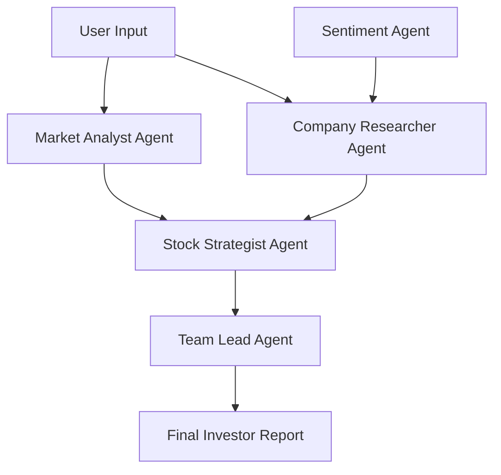

# 📈 Multi-Agent Stock Market Analysis System — Project Overview

> **Project Path:** `e:\Placement_Projects\Multi-Agent Stock Market Analysis System`
> **Generated:** 2026-07-20

---

## 🧭 Project Summary

**AI Investment Strategist** is a multi-agent, AI-powered stock market analysis application built using the **AGNO Agentic AI framework**, **Streamlit**, and **Yahoo Finance**. It allows users to analyze multiple stock symbols simultaneously, get AI-generated investment recommendations, perform news sentiment analysis, and simulate portfolio allocations — all through a clean, interactive web UI.

---

## 🗂️ Project Structure

```
StockMarketAgent-main/
├── app.py              # Frontend Streamlit application, UI logic, and charting
├── investment.py       # Backend AI logic — agent definitions and LLM orchestration
├── requirements.txt    # Python dependencies
├── .env                # API keys (gitignored)
├── .env.example        # Template for environment variables
├── .gitignore          # Git exclusions
├── README.md           # Basic project documentation
└── project_overview.md # Detailed project architecture document
```

---

## 🤖 Multi-Agent Architecture

The system uses **4 specialized AI agents** orchestrated by a Team Lead:



### 1. 📊 Market Analyst Agent
- Fetches **6 months** of historical stock data via Yahoo Finance
- Calculates cumulative **percentage price change** for each symbol
- **Ranks stocks** by relative performance
- Outputs plain markdown analysis

### 2. 🏢 Company Researcher Agent
- Retrieves **company profile** (name, sector, market cap, business summary)
- Fetches **latest 5 news articles** per stock
- Incorporates **news sentiment scores** from the Sentiment Agent
- Summarizes company fundamentals in investor-friendly markdown

### 3. 📈 Stock Strategist Agent
- Integrates market performance + company research
- Suggests **buy / sell / hold** decisions
- Computes **portfolio allocation percentages** for a given budget and risk tolerance
- Outputs an `ALLOCATION:` line parsed automatically by the system

### 4. 🧠 Team Lead Agent (Orchestrator)
- Compiles all agent outputs into a **single, ranked investment report**
- Opens report with: `## 🎯 AI Buy Decision & Entry Strategy` section
- Clearly names the **single best stock to buy** and the **ideal entry strategy**
- Formats the final output as structured markdown

### 5. 🗞️ News Sentiment Analysis Agent
- Dynamically spawned **per stock symbol**
- Accepts a prompt with news headlines and returns:
  - `SCORE`: −100 (extremely bearish) to +100 (extremely bullish)
  - `SENTIMENT`: Positive / Neutral / Negative
  - `SUMMARY`: One-sentence reasoning
- Score is clamped to `[−100, 100]`

---

## 🔧 Core Functions

### In `investment.py` (AI Logic)
| Function | Description |
|---|---|
| `get_model_instance(provider, model_id, api_key)` | Dynamically creates an LLM model instance based on user's provider selection |
| `get_investment_agents(model_instance)` | Instantiates all 4 agents with the chosen model |
| `analyze_news_sentiment(symbol, news_items, model_instance)` | Runs the sentiment agent and parses structured response |

### In `app.py` (Frontend & Orchestration)
| Function | Description |
|---|---|
| `compare_stocks(symbols)` | Fetches 6-month history and returns cumulative % change per stock |
| `fetch_live_metrics(symbol)` | Pulls live price, PE ratio, dividend yield, market cap, 52-week range |
| `get_company_info(symbol)` | Returns company name, sector, market cap, and business summary |
| `get_company_news(symbol)` | Returns latest 5 news articles from Yahoo Finance |
| `generate_optimized_investment_report(...)` | Orchestrates all agents and returns `(report, allocations, sentiment_data)` |

---

## 🖥️ Streamlit UI Breakdown

### Sidebar Controls
| Control | Type | Description |
|---|---|---|
| LLM Provider | Selectbox | Google Gemini / Groq / OpenAI |
| Model | Selectbox | Model ID based on provider |
| API Key | Password Input | Auto-filled from `.env` if set |
| Stock Symbols | Text Input | Comma-separated (default: AAPL, TSLA, GOOG) |
| Chart Timeframe | Selectbox | 1mo, 3mo, 6mo, 1y, 5y |
| Show SMA-20 | Checkbox | Overlay 20-Day Simple Moving Average |
| Show SMA-50 | Checkbox | Overlay 50-Day Simple Moving Average |
| Budget | Number Input | Investment budget in USD (default: $10,000) |
| Risk Tolerance | Selectbox | Conservative / Moderate / Aggressive |
| Generate Report | Button | Triggers the full multi-agent pipeline |

### Main Area — Output Sections

1. **💎 Live Financial Metrics Dashboard** — Real-time KPI cards per stock (price, daily change %, PE, yield, market cap)
2. **📰 News Sentiment Indicators** — Color-coded sentiment cards (green/yellow/red) per stock
3. **💼 Portfolio Simulator Allocation** — Pie chart + asset breakdown table
4. **📋 Detailed Investor Report** — Full AI-generated markdown report from Team Lead
5. **📊 Technical Charts** — Plotly line chart with optional SMA overlays
6. **📥 Download Results** — Downloadable markdown file of the full report

---

## 🌐 Supported LLM Providers & Models

| Provider | Models Available |
|---|---|
| **Google Gemini** | gemini-2.0-flash-001, gemini-2.0-flash-lite-preview-02-05, gemini-1.5-flash, gemini-1.5-pro |
| **Groq** | llama-3.3-70b-versatile, llama-3.1-8b-instant, mixtral-8x7b-32768 |
| **OpenAI** | gpt-4o-mini, gpt-4o |

---

## 📦 Dependencies

```txt
agno             # Multi-agent AI framework (AGNO)
google-genai     # Google Gemini SDK
plotly           # Interactive charts
python-dotenv    # .env file loading
streamlit        # Web UI framework
yfinance         # Yahoo Finance data fetcher
groq             # Groq LLM SDK
openai           # OpenAI SDK
```

**Minimum Python version:** 3.10+

---

## ⚙️ Environment Variables

Create a `.env` file at the project root:

```env
GOOGLE_API_KEY=your_google_api_key_here
GROQ_API_KEY=your_groq_api_key_here
OPENAI_API_KEY=your_openai_api_key_here
```

> [!NOTE]
> Only the key for your selected provider is required. Keys are also accepted directly in the UI sidebar.

---

## 🚀 Setup & Run Instructions

```bash
# 1. Clone the repository and navigate into it
cd StockMarketAgenticAI

# 2. Create and activate virtual environment
python -m venv .venv
.venv\Scripts\activate          # Windows
# source .venv/bin/activate     # macOS/Linux

# 3. Install dependencies
pip install -r requirements.txt

# 4. Add your API key to .env
# (or enter it directly in the Streamlit sidebar)

# 5. Run the application
streamlit run app.py
```

Open the local URL shown in terminal (typically `http://localhost:8501`).

---

## 🔄 Agent Pipeline Flow (Detailed)

```
User clicks "Generate Investment Report"
        │
        ▼
get_model_instance()          ← Creates LLM model object (investment.py)
        │
        ▼
fetch_live_metrics()          ← Real-time KPI per symbol (app.py)
        │
        ▼
generate_optimized_investment_report()
  ├── compare_stocks()         ← 6-month % change per symbol
  ├── market_analyst.run()     ← AI ranking & comparative analysis
  ├── for each symbol:
  │    ├── get_company_info()  ← Name, sector, market cap, summary
  │    ├── get_company_news()  ← Latest 5 news articles
  │    ├── analyze_news_sentiment() ← AI sentiment score & classification
  │    └── company_researcher.run() ← Full company research with sentiment
  ├── stock_strategist.run()   ← Allocation recommendation + ALLOCATION: line
  └── team_lead.run()          ← Final structured investment report
        │
        ▼
Render UI (app.py):
  ├── KPI Metric Cards
  ├── Sentiment Indicator Cards
  ├── Portfolio Pie Chart + Allocation Table
  ├── Markdown Investment Report
  ├── Plotly Stock Chart (+ optional SMA overlays)
  └── Downloadable .md Report
```

---

## 🛡️ Security & Best Practices

- `.env` and `.env.*` files are **gitignored** — API keys are never committed
- Streamlit Secrets (`secrets.toml`) are also excluded from git
- API keys are passed at runtime and scoped only to the active session
- Virtual environment (`.venv/`) is excluded from version control

---

## 📝 Key Design Decisions

| Decision | Rationale |
|---|---|
| Separation of Concerns | Splitting `app.py` (UI) and `investment.py` (AI logic) makes the codebase maintainable and scalable. |
| AGNO Agent Framework | Lightweight, flexible multi-agent orchestration without heavy infrastructure |
| Yahoo Finance (`yfinance`) | Free, no-API-key data source for real financial data |
| Dynamic LLM Provider Selection | User flexibility to use their preferred/available API key |
| Structured output parsing (ALLOCATION:, SCORE:) | Ensures machine-readable output from LLM agents without tool-calling overhead |
| Streamlit UI | Rapid prototyping of data-heavy dashboards with minimal frontend code |
| Plotly charts | Interactive, dark-themed charts with SMA overlay support |
| Single-pass agent orchestration | Minimizes redundant LLM calls — each agent runs exactly once (or once per symbol) |

---

## ⚠️ Known Limitations

- **No real-time streaming** — All agents run sequentially; report generation can take 30–90 seconds
- **Yahoo Finance rate limits** — Frequent requests may trigger temporary throttling
- **LLM output parsing is heuristic** — The `ALLOCATION:` and `SCORE:` parsing can fail if the model doesn't follow the exact format
- **No persistent storage** — Analysis results are session-only; download is required to save

---

*Generated by Antigravity AI — 2026-07-20*
